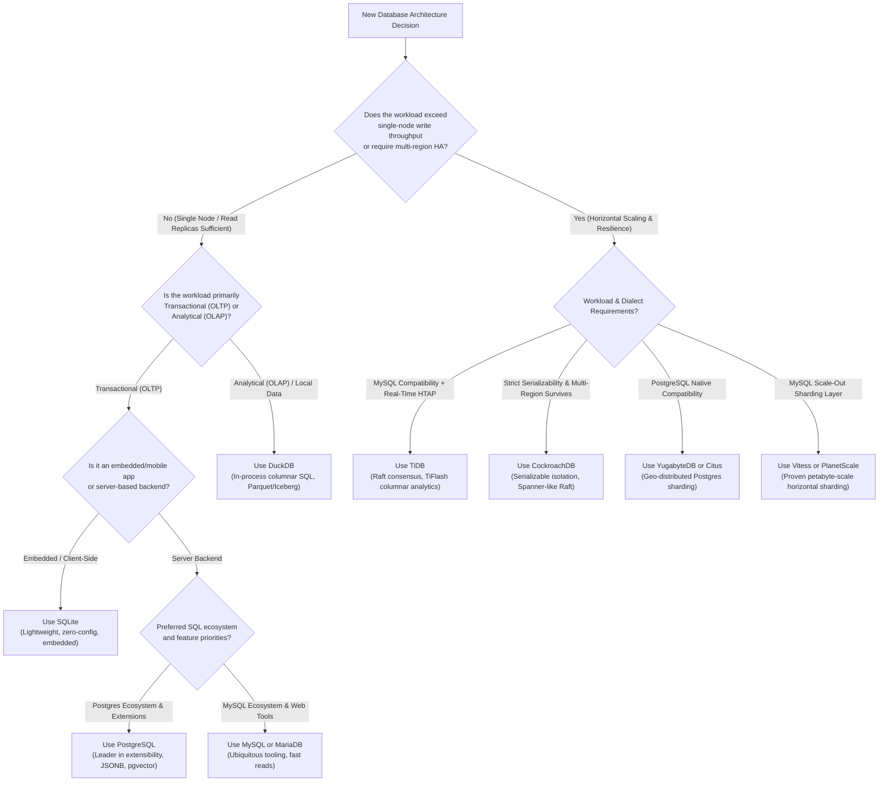

<p align="center">
  
</p>

# 🚀 Awesome Relational Databases

<p align="center">
  <a href="https://github.com/ishandutta2007/Awesome-Aeesome-Awesome"></a>
  <a href="https://discord.gg/jc4xtF58Ve"></a>
  <a href="LICENSE"></a>
  <a href="https://github.com/ishandutta2007/Awesome-Relational-Databases/stargazers"></a>
  <a href="https://github.com/ishandutta2007/Awesome-Relational-Databases/pulls"></a>
  <a href="https://github.com/ishandutta2007"></a>
</p>

> **A curated directory of Relational Database Management Systems (RDBMS), Cloud DBaaS Platforms, and Distributed SQL Engines.**  
> *Focused on ACID Transaction Guarantees, ANSI-SQL Standards Compliance, Horizontal Scalability, High Availability, and High-Throughput OLTP/HTAP Workloads.*

---

## 📑 Table of Contents

- [🌐 Sector Overview & Market Dynamics](#-sector-overview--market-dynamics)
- [🏢 Enterprise Cloud & SaaS Relational Databases](#-enterprise-cloud--saas-relational-databases)
- [💻 Top Open-Source Relational Database Engines](#-top-open-source-relational-database-engines)
- [⚙️ Technical Comparison Matrix](#️-technical-comparison-matrix)
- [🧭 Architectural Selection Guide](#-architectural-selection-guide)
- [🤝 How to Contribute](#-how-to-contribute)
- [⭐ Star History](#-star-history)
- [💖 Support & Community](#-support--community)
- [📜 Disclaimer](#-disclaimer)

---

## 🌐 Sector Overview & Market Dynamics

The global **Relational Database Management Systems (RDBMS)** market was valued at approximately **$72.5 Billion in 2024** and is projected to expand to over **$135.8 Billion by 2030**, exhibiting a compound annual growth rate (**CAGR of ~11.8%**). 

The industry remains **moderately concentrated to oligopolistic at the infrastructure tier**, where enterprise hyperscalers (**Microsoft, Amazon Web Services, Alphabet/Google, Oracle, and SAP**) command over **75% of cloud database runtime revenues**. Concurrently, the sector experiences a **vibrant, competitive open-source and modern distributed SQL expansion**—spearheaded by PostgreSQL extensions, serverless compute-storage separation engines (such as Neon and Supabase), and horizontally sharded consensus architectures (CockroachDB, TiDB, YugabyteDB) that disrupt legacy vendor lock-in.

---

## 🏢 Enterprise Cloud & SaaS Relational Databases

The following managed database-as-a-service (DBaaS) platforms provide automated replication, automated backups, zero-downtime maintenance, and horizontal or serverless elastic scaling. Products are **sorted in descending order by company size** (market capitalization for public entities or latest venture valuation for private entities).

| Provider & Platform | Company Size (Market Cap / Valuation) | Starting Tier Pricing | Free Tier / Trial Limits | Core Architecture & Engine Support |
| :--- | :--- | :--- | :--- | :--- |
| **[Azure SQL Database](https://azure.microsoft.com/en-us/products/azure-sql/)** <br>*(Microsoft)* | **~$3.12 Trillion** <br>*(Public: MSFT, FY24 Rev: $245B)* | **$4.99/mo** (Basic tier, 5 DTUs, 2 GB) or **$0.000145/vCore-sec** (~$5.40/mo at 0.5 vCore Serverless) | **Free Forever**: 32,000 vCore-seconds + 32 GB storage per month; plus **30-day trial with $200 free credits** | Fully managed SQL Server with automated vertical scaling, Hyperscale distributed tier, and native Azure AD integration. |
| **[Google Cloud SQL](https://cloud.google.com/sql)** <br>*(Alphabet / Google)* | **~$2.15 Trillion** <br>*(Public: GOOGL, FY24 Rev: $350B)* | **$0.0105/hr** (~$7.67/mo) for `db-f1-micro` + $0.170/GB/mo SSD storage | **90-Day Free Trial**: **$300 free credits** across GCP services (no permanent free compute instance) | Managed MySQL, PostgreSQL, and SQL Server with automatic replication, Multi-AZ failover, and point-in-time recovery up to 365 days. |
| **[Google Cloud Spanner](https://cloud.google.com/spanner)** <br>*(Alphabet / Google)* | **~$2.15 Trillion** <br>*(Public: GOOGL, FY24 Rev: $350B)* | **$0.099/hr** (~$72.27/mo) for 100 Processing Units (0.1 node) + $0.30/GB/mo storage | **90-Day Free Trial**: 1 instance with 100 Processing Units + 10 GB storage free for 90 days (plus $300 GCP credits) | Globally distributed, strongly consistent SQL engine utilizing TrueTime API (atomic clocks & GPS) with automated regional sharding. |
| **[Amazon RDS & Aurora](https://aws.amazon.com/rds/)** <br>*(Amazon Web Services)* | **~$2.05 Trillion** <br>*(Public: AMZN, FY24 Rev: $600B+)* | **$0.016/hr** (~$11.68/mo) for `db.t4g.micro` Single-AZ; Aurora Serverless v2 from **$0.12/ACU-hr** (~$0.06/hr at 0.5 ACU min) | **12 Months Free**: 750 hrs/mo of `db.t2.micro`, `db.t3.micro`, or `db.t4g.micro` + 20 GB SSD storage + 20 GB backup storage | Managed relational service across MySQL, PostgreSQL, MariaDB, Oracle, and SQL Server; Aurora distributed multi-AZ log-structured storage. |
| **[Oracle Autonomous Database](https://www.oracle.com/autonomous-database/)** <br>*(Oracle Corporation)* | **~$485 Billion** <br>*(Public: ORCL, FY24 Rev: $53B)* | **$0.336/ECPU-hr** (~$245/mo for 1 ECPU active baseline) + $0.025/GB/mo storage | **Always Free Tier**: 2 Autonomous Databases (ATP or ADW) with 1 ECPU and 20 GB storage each forever; plus **30-day $300 trial credit** | Self-driving, self-repairing, self-securing Oracle Database platform featuring automated index tuning, auto-patching, and ML workloads. |
| **[SAP HANA Cloud](https://www.sap.com/products/technology-platform/hana.html)** <br>*(SAP SE)* | **~$265 Billion** <br>*(Public: SAP, FY24 Rev: €31B / ~$34B)* | **$0.27/Capacity Unit-hr** (~$140/mo minimum operational baseline compute/storage allocation) | **Free Tier Model**: 1 instance of SAP HANA Cloud with up to 32 GB memory & 2 vCPUs (must renew every 30 days via login); plus **30-day trial** | In-memory relational database combining columnar storage for analytical speed with row-store ACID transactions for enterprise ERP/SAP. |
| **[CockroachDB Cloud](https://www.cockroachlabs.com/get-started-cockroachdb/)** <br>*(Cockroach Labs)* | **~$5.0 Billion** <br>*(Private: Series F, $5B Valuation)* | **$0.12 per 1M Request Units (RUs)** + **$0.75/GiB/mo** storage; Dedicated clusters from **$0.22/vCPU/hr** | **Free Forever Tier**: 50 Million Request Units (RUs) and 10 GiB storage free per month (no credit card required) | Distributed SQL database featuring serializable ACID isolation, native multi-region survival, Raft consensus, and Postgres wire compatibility. |
| **[SingleStore Helios](https://www.singlestore.com/)** <br>*(SingleStore Inc.)* | **~$1.3 Billion** <br>*(Private: Series F, $434M Raised)* | **$0.65/hr** (~$475/mo for S-0.5 workspace) or Starter burstable tier from **$0.16/hr** | **14-Day Free Trial**: **$600 complimentary compute credits** (no credit card required) to run distributed transactional/analytical workloads | Unified distributed SQL engine combining in-memory rowstores for OLTP with columnar disk storage for OLAP and vector search. |
| **[Neon Cloud](https://neon.tech/)** <br>*(Neon Inc.)* | **~$1.0 Billion** <br>*(Private: Series B, $1B Valuation)* | **$19.00/mo** (Launch plan, includes 10 GiB storage, 300 compute hours; overage at $0.16/CU-hr) | **Free Forever Plan**: 0.5 GiB storage, 1 project with up to 10 branching copies, and 100 active compute hours/month | Serverless PostgreSQL with complete compute and storage separation, scale-to-zero capability, and instant copy-on-write database branching. |
| **[PlanetScale](https://planetscale.com/)** <br>*(PlanetScale Inc.)* | **~$600 Million** <br>*(Private: Series C, $600M Valuation)* | **$39.00/mo** (Scaler plan, includes 10 GB storage, 1 Billion row reads, 10 Million row writes/mo) | **14-Day Free Trial**: Full access to Scaler Pro features, database branching, and non-blocking schema migrations with 5 GB storage | Serverless MySQL platform engineered on Vitess, featuring declarative schema deployments, zero-downtime migrations, and horizontal sharding. |

---

## 💻 Top Open-Source Relational Database Engines

The following repositories represent the leading open-source relational databases, distributed SQL systems, and relational extensions. **Sorted in descending order by GitHub stargazer count.**

---

### 1. [Supabase](https://github.com/supabase/supabase) [](https://github.com/supabase/supabase/stargazers)
- **License**: Apache-2.0
- **Overview**: The open-source Firebase alternative built natively on top of PostgreSQL. Provides instant auto-generated RESTful and GraphQL APIs, real-time database subscriptions via WebSockets, built-in authentication, storage, and pgvector embeddings while maintaining 100% standard SQL and ACID transaction compatibility.
- **Key Capabilities**: Full PostgreSQL access, real-time CDC (Change Data Capture), fine-grained Row-Level Security (RLS), and AI vector search.

---

### 2. [DuckDB](https://github.com/duckdb/duckdb) [](https://github.com/duckdb/duckdb/stargazers)
- **License**: MIT
- **Overview**: An in-process, columnar relational SQL database management system engineered for analytical (OLAP) query workloads. Often referred to as the "SQLite for analytics," DuckDB executes directly within the host process memory space without separate server daemon management.
- **Key Capabilities**: Vectorized columnar query execution, native reading and writing of Parquet, JSON, Iceberg, and CSV, and full ACID transaction guarantees on local database files.

---

### 3. [TiDB](https://github.com/pingcap/tidb) [](https://github.com/pingcap/tidb/stargazers)
- **License**: Apache-2.0
- **Overview**: PingCAP's distributed Hybrid Transactional and Analytical Processing (HTAP) database. Designed to deliver horizontal scale-out for relational workloads with MySQL wire and syntax compatibility.
- **Key Capabilities**: Strong consistency via Multi-Raft consensus, automated horizontal sharding, decoupled compute (TiDB) and storage (TiKV row-store + TiFlash columnar engine), and real-time operational analytics without ETL.

---

### 4. [CockroachDB](https://github.com/cockroachdb/cockroach) [](https://github.com/cockroachdb/cockroach/stargazers)
- **License**: BSL 1.1 / CCL
- **Overview**: A cloud-native, distributed SQL database modeled after Google Spanner. Engineered to provide horizontal scaling, zero-downtime multi-region survivability, and serializable transactional consistency without proprietary hardware.
- **Key Capabilities**: Serializable ACID isolation, automated data range splitting and repair, multi-datacenter consensus via Raft, and PostgreSQL dialect wire compatibility.

---

### 5. [Dolt](https://github.com/dolthub/dolt) [](https://github.com/dolthub/dolt/stargazers)
- **License**: Apache-2.0
- **Overview**: "Git for data"—a relational database with native Git-like version control mechanics (branching, merging, commits, diffing, pushing, and pulling) implementing MySQL protocol compatibility.
- **Key Capabilities**: Prolly tree content-addressed storage engine, cell-level data and schema merges, point-in-time historical data auditability, and ACID transactions.

---

### 6. [TimescaleDB](https://github.com/timescale/timescaledb) [](https://github.com/timescale/timescaledb/stargazers)
- **License**: Apache-2.0 / Timescale License
- **Overview**: An open-source relational time-series database packaged as an extension for PostgreSQL. Delivers automated time-based partitioning and columnar compression while preserving full SQL joins and relations.
- **Key Capabilities**: Hypertables for auto-partitioning across time and space, up to 95% columnar compression, continuous aggregates, and complete interoperability with the entire PostgreSQL ecosystem.

---

### 7. [pgvector](https://github.com/pgvector/pgvector) [](https://github.com/pgvector/pgvector/stargazers)
- **License**: PostgreSQL License
- **Overview**: Open-source vector similarity search extension for PostgreSQL. Enables relational databases to store high-dimensional embeddings and execute vector search alongside structured business tables within single ACID transactions.
- **Key Capabilities**: HNSW and IVFFlat indexing algorithms, L2 distance, cosine distance, inner product, and seamless execution with PostgreSQL joins, indexes, and filters.

---

### 8. [PostgreSQL](https://github.com/postgres/postgres) [](https://github.com/postgres/postgres/stargazers)
- **License**: PostgreSQL License (Permissive)
- **Overview**: Widely recognized as the world's most advanced open-source relational database. Features complete SQL standard compliance, multi-version concurrency control (MVCC), rich data indexing (B-tree, GiST, GIN, BRIN), and an unmatched open extension ecosystem.
- **Key Capabilities**: Native JSONB semi-structured documents, table partitioning, asynchronous I/O (`io_uring`), complex window functions, and rock-solid ACID reliability.

---

### 9. [Vitess](https://github.com/vitessio/vitess) [](https://github.com/vitessio/vitess/stargazers)
- **License**: Apache-2.0 (CNCF Graduated)
- **Overview**: A database clustering middleware for horizontal scaling of MySQL. Originally created by YouTube to manage massive petabyte-scale relational traffic, Vitess abstracts sharding and connection pooling transparently.
- **Key Capabilities**: Dynamic resharding, connection multiplexing (VTGate), distributed query planning, and Kubernetes integration via Vitess Operator.

---

### 10. [rqlite](https://github.com/rqlite/rqlite) [](https://github.com/rqlite/rqlite/stargazers)
- **License**: MIT
- **Overview**: A lightweight, distributed relational database built on the SQLite storage engine and HashiCorp Raft consensus protocol. Offers an effortless operational footprint with strong fault tolerance.
- **Key Capabilities**: Single binary deployment, HTTP/REST API with transaction support, automated node discovery, and quorum-based distributed high availability.

---

### 11. [QuestDB](https://github.com/questdb/questdb) [](https://github.com/questdb/questdb/stargazers)
- **License**: Apache-2.0
- **Overview**: A high-performance SQL database engineered for time-series and event data with relational capabilities. Combines zero-GC execution, SIMD hardware acceleration, and the PostgreSQL wire protocol.
- **Key Capabilities**: Nanosecond timestamp resolution, columnar memory-mapped storage, out-of-order data ingestion, and relational SQL query execution.

---

### 12. [Citus](https://github.com/citusdata/citus) [](https://github.com/citusdata/citus/stargazers)
- **License**: AGPL-3.0
- **Overview**: A PostgreSQL extension developed by Microsoft that transforms standard Postgres into a horizontally scalable distributed database by sharding data across multiple worker nodes.
- **Key Capabilities**: Distributed tables, reference tables, real-time parallel query planning across cluster nodes, and purpose-built architectures for multi-tenant SaaS.

---

### 13. [MySQL Server](https://github.com/mysql/mysql-server) [](https://github.com/mysql/mysql-server/stargazers)
- **License**: GPL-2.0
- **Overview**: The world's most ubiquitous open-source relational database. Underpins millions of enterprise production stacks and web applications (WordPress, Drupal, LAMP, and modern cloud microservices).
- **Key Capabilities**: InnoDB ACID storage engine, row-level locking, group replication, dual-engine query execution, and broad hosting and driver support across all ecosystems.

---

### 14. [SQLite](https://github.com/sqlite/sqlite) [](https://github.com/sqlite/sqlite/stargazers)
- **License**: Public Domain
- **Overview**: A small, fast, self-contained, high-reliability, full-featured SQL database engine. The most widely deployed software library in human history, embedded inside mobile phones, web browsers, IoT devices, and desktop applications.
- **Key Capabilities**: Zero-configuration, single cross-platform disk file format, atomic transactions via write-ahead logging (WAL), and minimal resource consumption.

---

### 15. [YugabyteDB](https://github.com/yugabyte/yugabyte-db) [](https://github.com/yugabyte/yugabyte-db/stargazers)
- **License**: Apache-2.0
- **Overview**: A cloud-native distributed SQL database featuring dual API layers: YSQL (fully PostgreSQL wire and syntax compatible) and YCQL (Cassandra QL compatible).
- **Key Capabilities**: Raft-based distributed consensus, distributed transactions with hybrid logical clocks (HLC), multi-cloud active-active deployments, and auto-sharding.

---

### 16. [OceanBase](https://github.com/oceanbase/oceanbase) [](https://github.com/oceanbase/oceanbase/stargazers)
- **License**: MulanPubL-2.0
- **Overview**: An enterprise distributed relational database originally developed by Ant Group and Alibaba. Designed to handle extreme transactional concurrency with high availability and zero data loss (RPO = 0).
- **Key Capabilities**: Multi-tenant resource isolation, Paxos distributed consensus, transparent scale-out, columnar storage hybrid execution, and MySQL/Oracle syntax compatibility.

---

### 17. [MariaDB Server](https://github.com/MariaDB/server) [](https://github.com/MariaDB/server/stargazers)
- **License**: GPL-2.0
- **Overview**: The community-governed open-source fork of MySQL created by the original founders of MySQL. Serves as a drop-in replacement with enhanced replication, performance, and modern features.
- **Key Capabilities**: Galera multi-master synchronous clustering, pluggable storage engines (Aria, ColumnStore, MyRocks), temporal tables, and integrated vector search.

---

### 18. [PostGIS](https://github.com/postgis/postgis) [](https://github.com/postgis/postgis/stargazers)
- **License**: GPL-2.0
- **Overview**: The geospatial relational extender for PostgreSQL. Adds spatial data types, spatial indexing (GiST / R-Tree), and hundreds of geospatial functions enabling complex location queries directly in SQL.
- **Key Capabilities**: OpenGIS compliance, spatial reprojection algorithms, raster and vector geometry processing, and 3D geospatial distance calculations.

---

### 19. [Percona Server for MySQL](https://github.com/percona/percona-server) [](https://github.com/percona/percona-server/stargazers)
- **License**: GPL-2.0
- **Overview**: A hardened, enterprise-ready drop-in replacement for MySQL. Includes advanced performance diagnostics, connection thread pooling, and high-performance storage plugins.
- **Key Capabilities**: Percona XtraDB engine optimizations, MyRocks LSM-tree storage engine, enterprise audit logging, data masking, and deep integration with Percona XtraBackup.

---

## ⚙️ Technical Comparison Matrix

A comparative evaluation of foundational relational architectures:

| Engine | Primary Architecture | Consensus / Replication | SQL Wire Protocol | ACID Isolation Level | Optimal Workload |
| :--- | :--- | :--- | :--- | :--- | :--- |
| **PostgreSQL** | Single-Node / Extensible | Streaming Replication | Native PostgreSQL | Read Committed / Serializable | General-purpose transactional applications, spatial, vectors |
| **MySQL / MariaDB** | Single-Node / Clustered | Semi-sync / Galera Multi-Master | Native MySQL | Repeatable Read / Serializable | Web applications, e-commerce, high-throughput single-node reads |
| **CockroachDB** | Distributed Multi-Master | Raft Protocol | PostgreSQL Compatible | Strict Serializable | Multi-region mission-critical OLTP, global banking |
| **TiDB** | Distributed HTAP | Multi-Raft (TiKV / TiFlash) | MySQL Compatible | Snapshot Isolation / Read Committed | Massive OLTP with real-time operational analytics |
| **YugabyteDB** | Distributed Multi-Model | Raft Consensus | PostgreSQL (YSQL) / Cassandra | Snapshot / Serializable | Multi-cloud geo-distributed apps needing PostgreSQL features |
| **DuckDB** | In-Process Columnar | Local File / Single Process | PostgreSQL Dialect | Serializable | Local analytics, data wrangling, embedded fast OLAP |
| **SQLite** | Embedded Serverless | Local Disk / Raft (via rqlite) | SQLite Native | Serializable | Mobile apps, IoT, desktop applications, embedded systems |
| **Supabase** | Cloud-Native BaaS | Postgres Replication | PostgreSQL Native | Read Committed / Serializable | Jamstack apps, full-stack web/mobile, real-time vector apps |

---

## 🧭 Architectural Selection Guide



---

## 🤝 How to Contribute

Contributions from database administrators, systems engineers, and open-source contributors are welcome!

1. **Fork the repository**: Click the `Fork` button at top-right.
2. **Clone your fork**:
   ```bash
   git clone https://github.com/<your-username>/Awesome-Relational-Databases.git
   ```
3. **Add or update an entry**:
   - Ensure the database is actively maintained.
   - Maintain objective, factual descriptions with appropriate technical metrics.
   - Include pricing and exact free-tier/trial limits for SaaS entries.
   - For open-source additions, include the official stargazer badge linked to its `/stargazers` page.
4. **Submit a Pull Request**: Provide a clear explanation of additions or benchmarks in your PR description.

For more awesome lists, explore the [Awesome Collection](https://github.com/ishandutta2007/Awesome-Awesome-Awesome).

---

## ⭐ Star History

[](https://star-history.dera.page/#ishandutta2007/Awesome-Relational-Databases&type=date&legend=top-left)

---

## 💖 Support & Community

Thank you for exploring **Awesome-Relational-Databases**! If this directory assists your architecture designs or database research:

- ⭐ **Star this repository** to bookmark it and help others discover it.
- 🍴 **Fork and contribute** by submitting pull requests with benchmarks, new engines, or documentation improvements.
- 📢 **Share with colleagues** across engineering teams, database forums, and social media.
- ☕ **Support Ongoing Curation**: If you would like to support continuous research, testing, and open-source maintenance, please consider buying a coffee or contributing via the [GitHub Sponsor Dashboard](https://github.com/sponsors/ishandutta2007).

<p align="center">
  <a href="https://github.com/sponsors/ishandutta2007">
    
  </a>
</p>

---

## 📜 Disclaimer

- This is a community-curated, independent directory provided for educational and architectural evaluation purposes. Trademarks and product names belong to their respective owners.
- **Performance profiles depend heavily on specific hardware, schema normalization, index strategies, and concurrency patterns.** Always benchmark with your application's actual transaction profile before finalizing infrastructure decisions.
- Self-hosted relational systems require appropriate backup schedules, replication monitoring, connection pooling (e.g., PgBouncer, ProxySQL), and transaction log maintenance.

---

<p align="center">
  <b>Built with ❤️ for database architects, DevOps engineers, and backend developers worldwide.</b>
</p>
